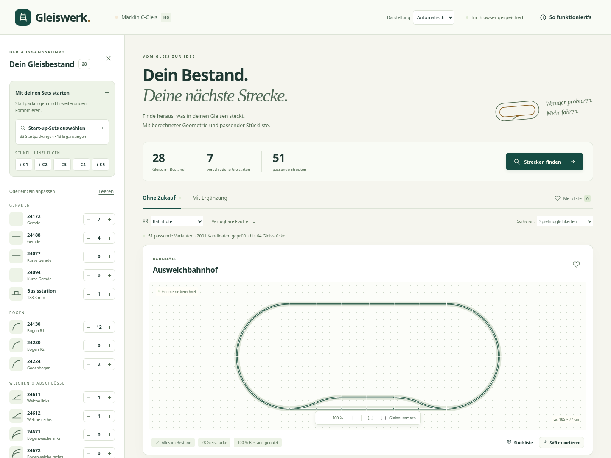
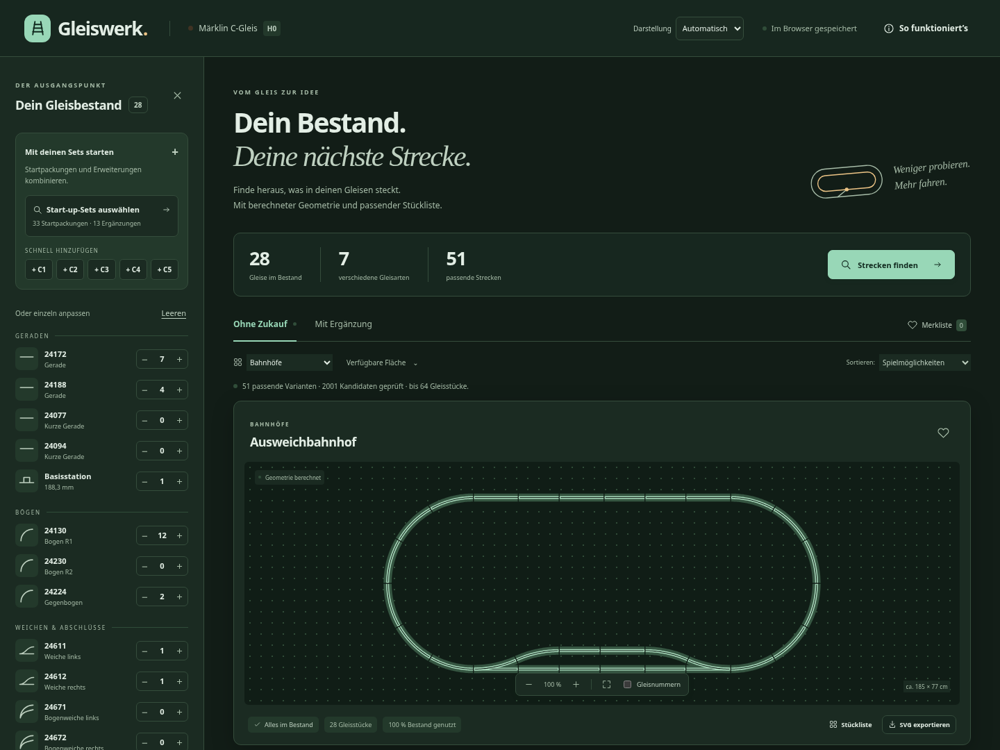
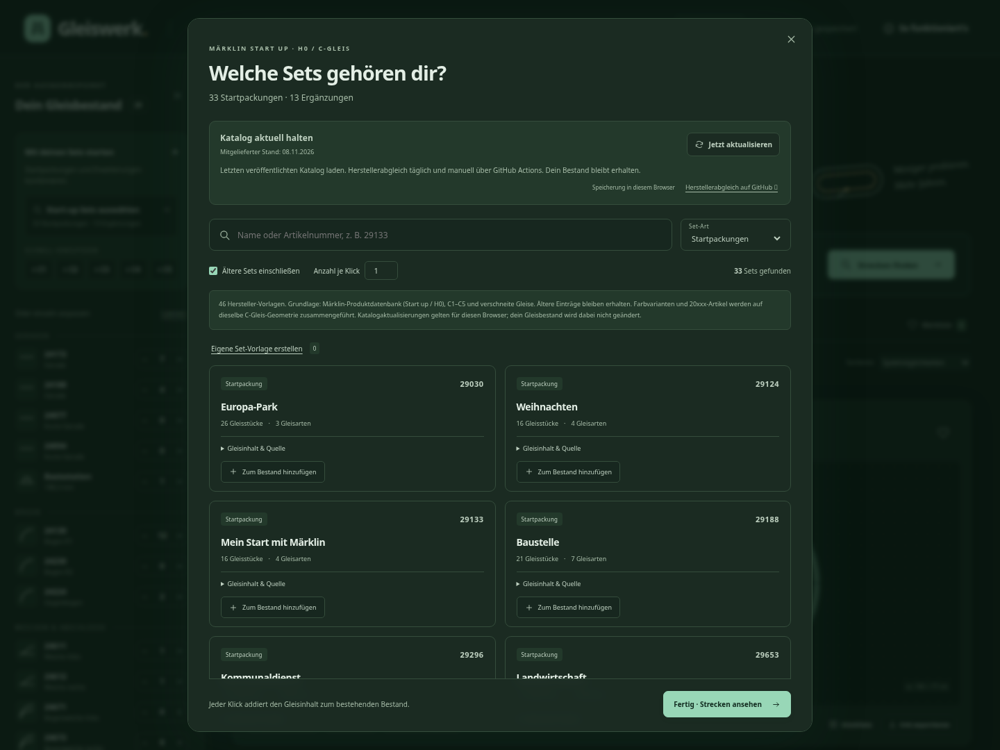

# Gleiswerk

Aus deinem Gleisbestand wird ein Gleisplan: Gleiswerk hilft dir, passende Strecken für **Märklin Start up und das H0-C-Gleis** zu entdecken.

**[App öffnen →](https://pheelee.github.io/gleiswerk/)**

## Was du damit machen kannst

- **Bestand erfassen:** Startpackungen und Ergänzungssets nach Name oder Artikelnummer auswählen, einzelne Gleise ergänzen und eigene Set-Vorlagen anlegen.
- **Strecken entdecken:** Rundstrecken, Abstellgleise, Bahnhöfe und Rangiermöglichkeiten aus deinem Bestand anzeigen lassen.
- **Gezielt erweitern:** Unter „Mit Ergänzung“ sehen, welche zusätzlichen Gleise für einen Plan fehlen.
- **Pläne vergleichen:** Nach Streckenart und verfügbarer Fläche filtern, in die Zeichnung zoomen und die Stückliste öffnen.
- **Pläne mitnehmen:** Pläne in der Merkliste behalten, Gleispläne als SVG speichern und den Bestand als JSON exportieren oder importieren.

## Streckenplanung

Bestand, Gleisplan, Platzbedarf und passende Alternativen auf einen Blick.

## Dunkles Design

Die Darstellung folgt standardmäßig deiner Browser-Einstellung. Über „Darstellung“ kannst du auch dauerhaft Hell oder Dunkel wählen.

## Set-Auswahl

Suche nach deinen Startpackungen und Ergänzungen. Jede Hersteller-Vorlage zeigt ihre Gleis-Stückliste und Quellen; auch ältere Sets lassen sich einbeziehen.

## So legst du los

1. Öffne die Set-Auswahl und füge deine Packungen hinzu – oder trage einzelne Gleise direkt ein.
2. Entdecke Pläne unter „Ohne Zukauf“ oder prüfe mögliche Erweiterungen unter „Mit Ergänzung“.
3. Wähle einen Plan, kontrolliere Platzbedarf und Stückliste und speichere ihn als SVG.

Zum Ausprobieren kannst du über **„Beispiel: Startpackung + C2 laden“** einen Beispielbestand verwenden. Den neuesten veröffentlichten Set-Katalog lädst du in der Set-Auswahl über **„Jetzt aktualisieren“**.

## Deine Daten und die Planung

Gleiswerk funktioniert ohne Anmeldung. Dein Bestand, deine Merkliste und eigene Vorlagen werden in deinem Browser gespeichert. Zum Wechsel auf ein anderes Gerät oder einen anderen Browser kannst du deinen Bestand als JSON übertragen.

Die Suche prüft Gleisverbindungen und Abstände innerhalb ausgewählter Streckenfamilien. Sie zeigt keine vollständige Aufzählung aller denkbaren Gleisnetze und berücksichtigt keine Steigungen, Brücken oder Fahrzeugüberhänge.

Gleiswerk ist ein unabhängiges Planungswerkzeug und kein offizielles Angebot von Märklin.
